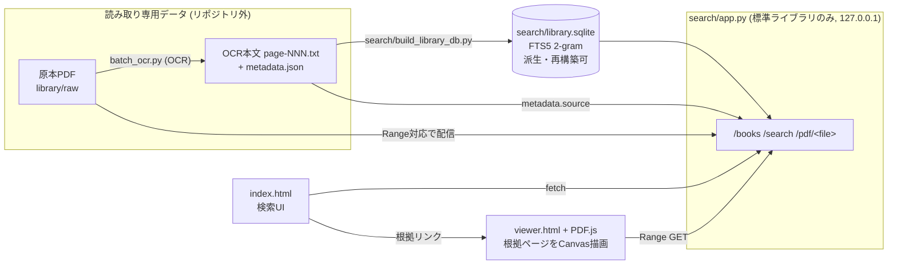

# 構成図

## 検索の流れ

1. クエリを2文字n-gramに分解し、SQLite FTS5で候補ページを絞り込む。
2. 補正規則(`corrections.json`)適用後の `search_text` で厳密な部分一致を確認する(1文字検索も可)。
3. `citation_id` (`book_id:part_file:pdf-pN`)・snippet・ビューアURLを返す。

## データ保護の境界

- 原本PDFとOCR結果は読み取り専用。本システムは書き込まない。
- `library.sqlite` は派生物で、削除しても `build_library_db.py` で再構築できる。
- 既定の待受は `127.0.0.1`(`BOOK_SEARCH_HOST` で変更可)。認証は未実装のため、外部公開する場合はリバースプロキシ等でアクセス制御を行うこと。
